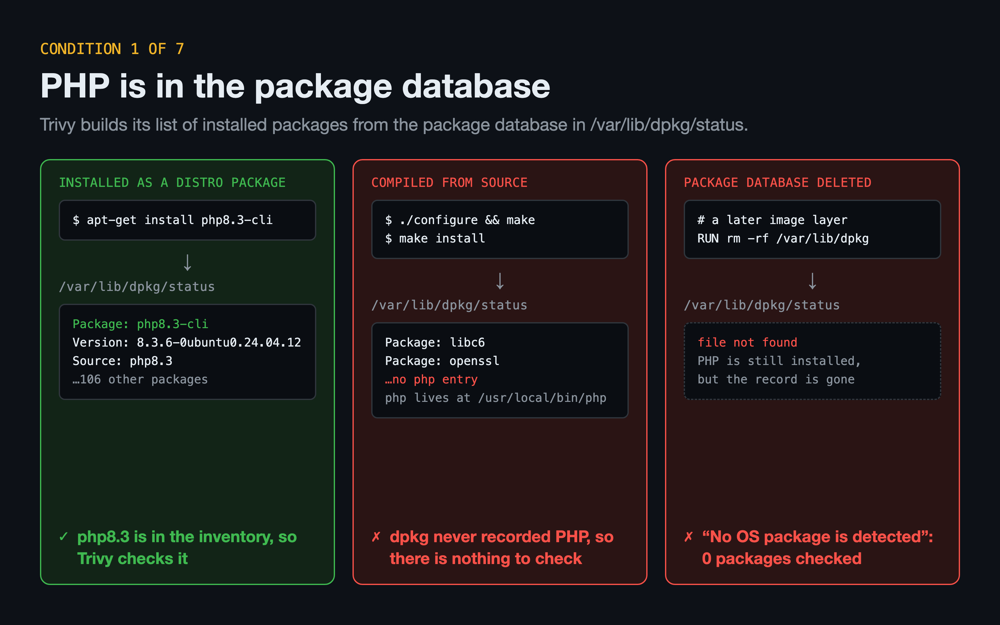
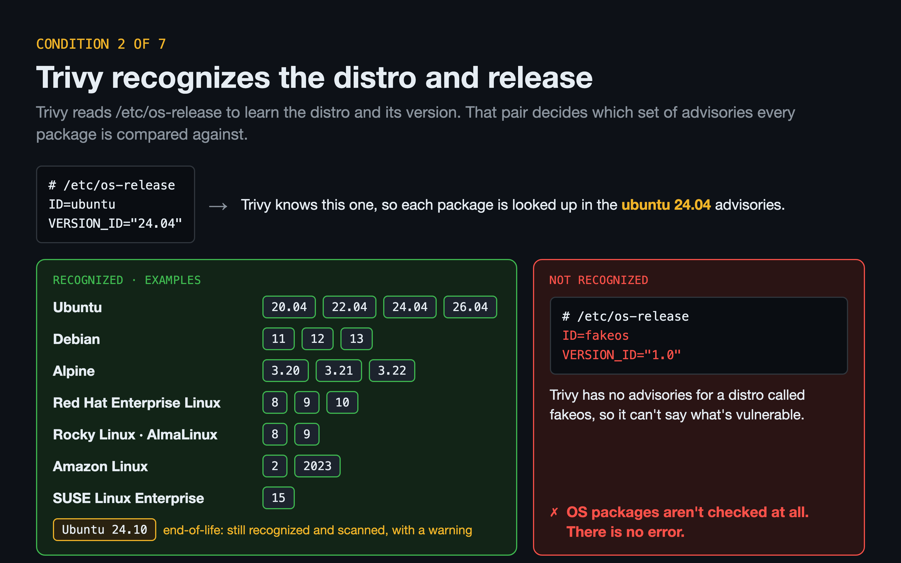
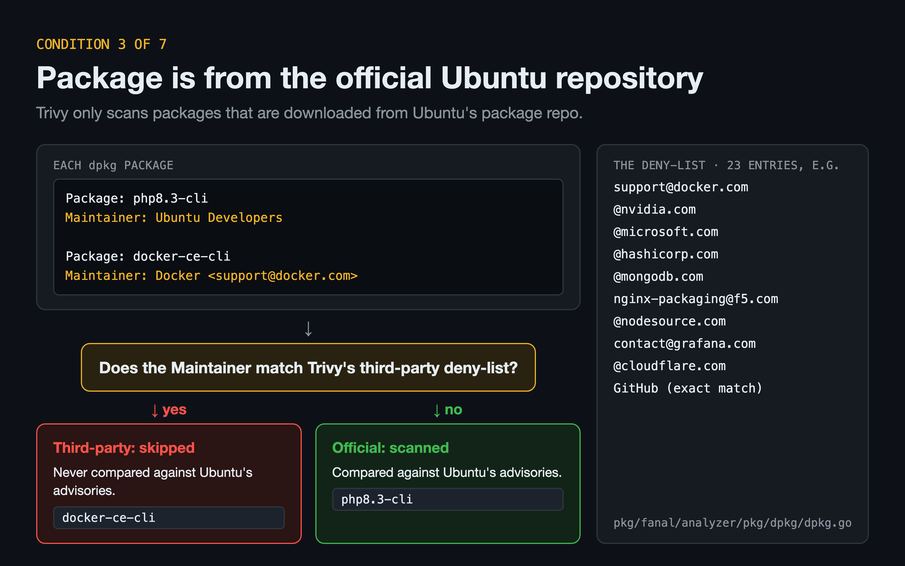
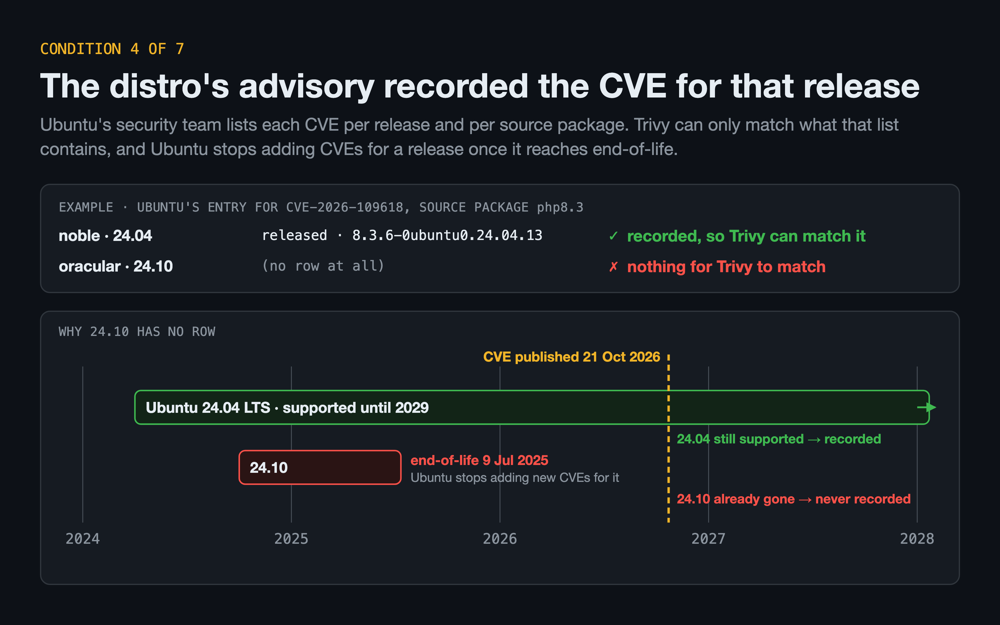
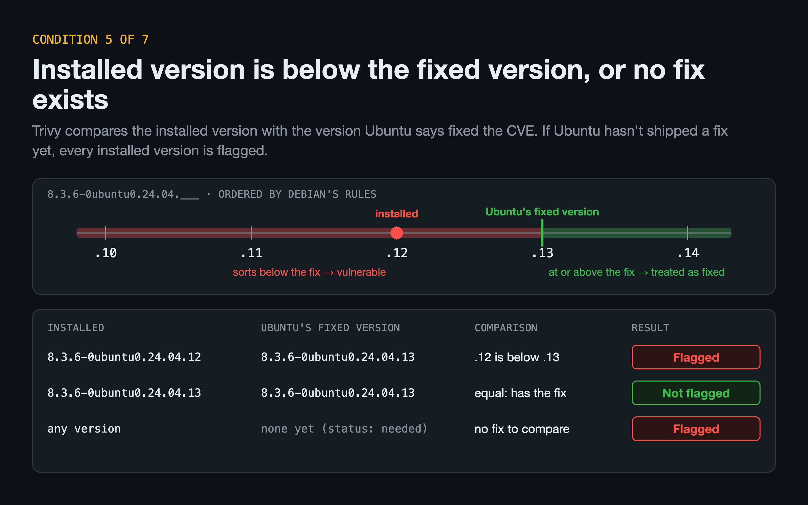
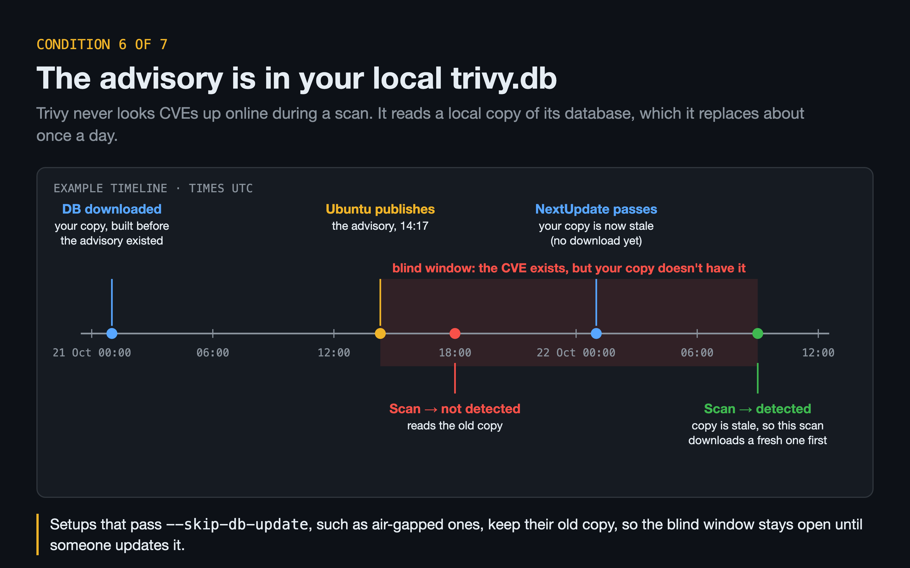
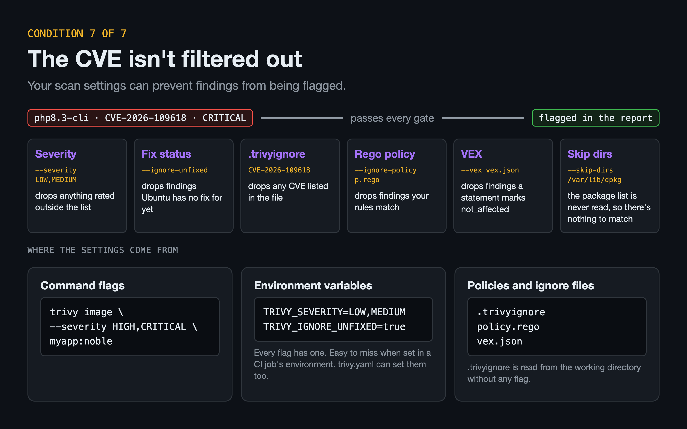

# detecting-php2shell-with-trivy

You'll need Docker (with Compose), `jq` and `curl`.

```bash
docker compose up -d --build
docker compose --profile tools build stale-db
alias trivy='docker run --rm -v /var/run/docker.sock:/var/run/docker.sock aquasec/trivy:0.76.1'
```

## 1. How does Trivy figure out what's installed in an image?



**Holds**

```bash
docker compose exec c1-holds php -v | head -1
docker compose exec c1-holds dpkg -l 'php8.3*' | awk '/^ii/ {print $2, $3}'
trivy image -q --list-all-pkgs -f json php2shell:c1-holds | jq -r '.Results[].Packages[].Name' | grep php
```

**Broken: PHP built from source**

```bash
docker compose exec c1-broken-source php -v | head -1
docker compose exec c1-broken-source dpkg -l 'php8.3*'
trivy image -q --list-all-pkgs -f json php2shell:c1-broken-source | jq -r '.Results[].Packages[].Name' | grep php
```

**Broken: dpkg database deleted**

```bash
docker compose exec c1-broken-no-db php -v | head -1
docker compose exec c1-broken-no-db dpkg -l 'php8.3*'
trivy image php2shell:c1-broken-no-db 2>&1 | grep -o 'No OS package is detected.*'
```

## 2. Why does Trivy care which distro and release you're running?



**Holds**

```bash
docker compose exec c2-holds grep -E '^(ID|VERSION_ID)=' /etc/os-release
trivy image -q -f json php2shell:c2-holds | jq -c .Metadata.OS
trivy image -q -f json php2shell:c2-holds | grep -c '"VulnerabilityID": "CVE-2026-109618"'
```

**Broken**

```bash
docker compose exec c2-broken grep -E '^(ID|VERSION_ID)=' /etc/os-release
docker compose exec c2-broken ls /etc/lsb-release /etc/debian_version
trivy image -q -f json php2shell:c2-broken | jq -c .Metadata.OS
trivy image -q -f json php2shell:c2-broken | grep -c '"VulnerabilityID": "CVE-2026-109618"'
```

## 3. When does Trivy skip a package?



**Holds**

```bash
docker compose exec c3-holds dpkg-query -W -f='${Package}: ${Maintainer}\n' 'php8.3-*' | grep @
trivy image --debug php2shell:c3-holds 2>&1 | grep -o 'Skipping third-party packages.*'
trivy image -q -f json php2shell:c3-holds | grep -c '"VulnerabilityID": "CVE-2026-109618"'
```

**Broken (simulated)**

```bash
docker compose exec c3-broken dpkg-query -W -f='${Package}: ${Maintainer}\n' 'php8.3-*' | grep @
trivy image --debug php2shell:c3-broken 2>&1 | grep -o 'Skipping third-party packages.*'
trivy image -q -f json php2shell:c3-broken | grep -c '"VulnerabilityID": "CVE-2026-109618"'
```

## 4. When does Trivy consider a package vulnerable?



**Holds**

```bash
docker compose exec c4-holds grep VERSION_CODENAME /etc/os-release
docker compose exec c4-holds dpkg-query -W php8.3-cli
curl -s https://raw.githubusercontent.com/aquasecurity/vuln-list/main/ubuntu/2026/CVE-2026-109618.json | jq -c '.Patches."php8.3".noble'
trivy image -q -f json php2shell:c4-holds | grep -c '"VulnerabilityID": "CVE-2026-109618"'
```

**Broken**

```bash
docker compose exec c4-broken grep VERSION_CODENAME /etc/os-release
docker compose exec c4-broken dpkg-query -W php8.3-cli
curl -s https://raw.githubusercontent.com/aquasecurity/vuln-list/main/ubuntu/2026/CVE-2026-109618.json | jq -c '.Patches."php8.3".oracular'
trivy image php2shell:c4-broken 2>&1 | grep -o 'This OS version is no longer supported.*'
trivy image -q -f json php2shell:c4-broken | grep -c '"VulnerabilityID": "CVE-2026-109618"'
```

## 5. How does Trivy tell a vulnerable version from a patched one?



**Holds**

```bash
docker compose exec c5-holds dpkg-query -W -f='${Version}\n' php8.3-cli
docker compose exec c5-holds sh -c 'dpkg --compare-versions "$(dpkg-query -W -f="\${Version}" php8.3-cli)" lt 8.3.6-0ubuntu0.24.04.13 && echo below fix || echo at/after fix'
trivy image -q -f json php2shell:c5-holds | grep -c '"VulnerabilityID": "CVE-2026-109618"'
```

**Broken**

```bash
docker compose exec c5-broken dpkg-query -W -f='${Version}\n' php8.3-cli
docker compose exec c5-broken sh -c 'dpkg --compare-versions "$(dpkg-query -W -f="\${Version}" php8.3-cli)" lt 8.3.6-0ubuntu0.24.04.13 && echo below fix || echo at/after fix'
trivy image -q -f json php2shell:c5-broken | grep -c '"VulnerabilityID": "CVE-2026-109618"'
```

## 6. Where does Trivy keep its CVE data?



**Holds**

```bash
docker run --rm php2shell:stale-db --cache-dir /fresh version | grep UpdatedAt
docker run --rm --entrypoint dbkey php2shell:stale-db get /fresh/db/trivy.db 'ubuntu 24.04' php8.3 CVE-2026-109618
trivy image -q -f json php2shell:c6-holds | grep -c '"VulnerabilityID": "CVE-2026-109618"'
```

**Broken (simulated)**

```bash
docker run --rm php2shell:stale-db version | grep UpdatedAt
docker run --rm --entrypoint dbkey php2shell:stale-db get /root/.cache/trivy/db/trivy.db 'ubuntu 24.04' php8.3 CVE-2026-109618
docker run --rm -v /var/run/docker.sock:/var/run/docker.sock php2shell:stale-db image -q -f json --skip-db-update php2shell:c6-holds | grep -c '"VulnerabilityID": "CVE-2026-109618"'
```

## 7. Why might a vulnerable package not show up in the report?



**Holds**

```bash
trivy image -q -f json php2shell:c7-holds | jq -r '.Results[].Vulnerabilities[]? | select(.VulnerabilityID=="CVE-2026-109618") | .Severity' | sort -u
trivy image -q -f json php2shell:c7-holds | grep -c '"VulnerabilityID": "CVE-2026-109618"'
```

**Broken**

```bash
trivy image -q -f json --severity LOW,MEDIUM php2shell:c7-holds | grep -c '"VulnerabilityID": "CVE-2026-109618"'
docker run --rm -e TRIVY_SEVERITY=LOW,MEDIUM -v /var/run/docker.sock:/var/run/docker.sock aquasec/trivy:0.76.1 image -q -f json php2shell:c7-holds | grep -c '"VulnerabilityID": "CVE-2026-109618"'
cat scenarios/c7-filters/.trivyignore
docker run --rm -v "$PWD/scenarios/c7-filters/.trivyignore:/.trivyignore" -v /var/run/docker.sock:/var/run/docker.sock aquasec/trivy:0.76.1 image -q -f json --ignorefile /.trivyignore php2shell:c7-holds | grep -c '"VulnerabilityID": "CVE-2026-109618"'
```

## All conditions at once

```bash
trivy image -q -f json php2shell:all-conditions | jq -r '.Results[].Vulnerabilities[]? | select(.VulnerabilityID=="CVE-2026-109618") | [.PkgName, .InstalledVersion, .FixedVersion, .Severity] | @tsv'
```
